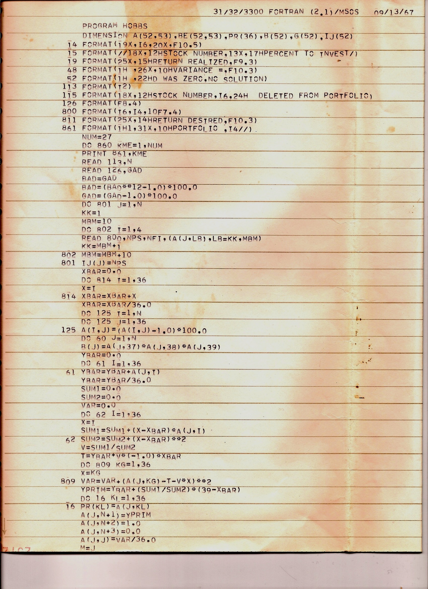
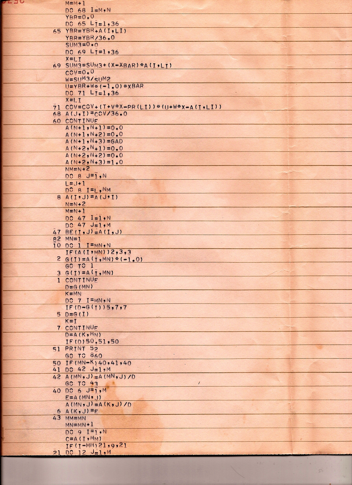
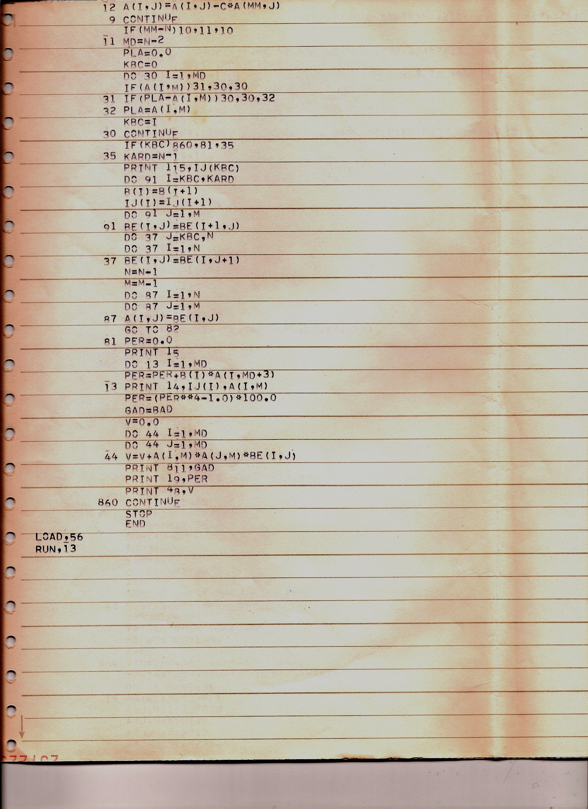

# The Original Program

Program HOBBS, a Fortran 2.1 program written in 1967 to test the Markowitz method of portfolio selection, is the
original of Markowitz's analysis ([backend/markowitz.bare](../backend/markowitz.bare)'s `markowitzAnalyze`). The
program's three pages, and the 2009 email from its author that sent them, follow.

## Fortran 2.1 Program

**From:** Craig & Jan Hobbs\
**To:** Craig Hobbs\
**Date:** Tuesday, April 28, 2009, 5:17 PM

Craig,

I found the old Fortran program I wrote in 1967 to test the Markowitz method. Actually, I used Fortran 2.1, which was
the new release at the time.

See attached program. The maximum number of stocks that the IBM mainframe could handle was 52x52 -- that was a brand
new mainframe at OSU that I was able to use in July-August, 1967.

I'll send you a copy of the paper I wrote in late 1966, describing how the Markowitz method works. It reads like it is
over 40 years old -- which it is. You'll get a kick out of some of the statements in the paper.

Dad

### Attachments

